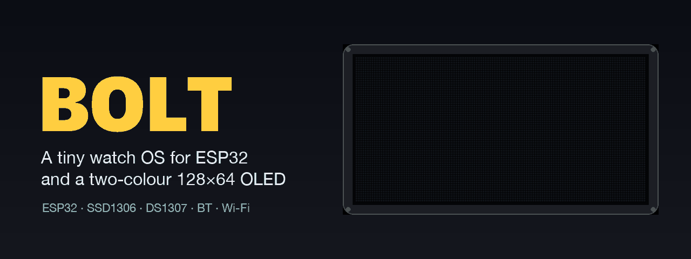
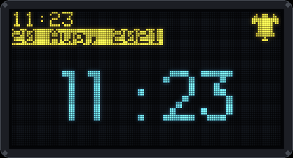
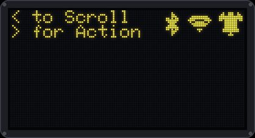
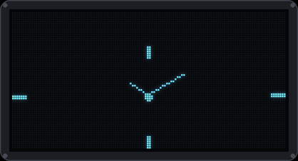
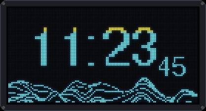
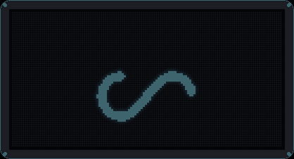
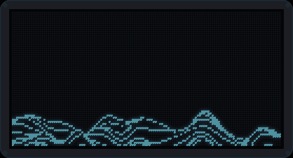
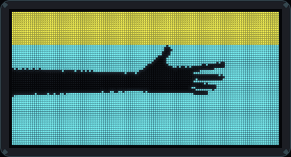
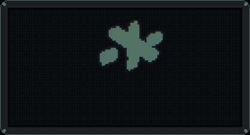
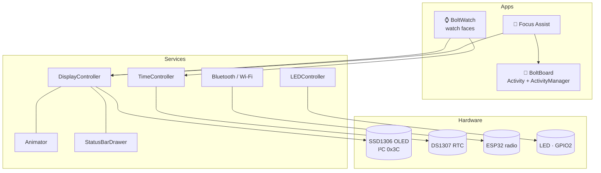

<p align="center">
  
</p>

<p align="center">
  
  
  
  
  
</p>

**Bolt** ⚡ is a tiny watch "operating system" for the ESP32. It drives a 0.96" two-colour SSD1306 OLED: a **yellow 16-pixel status bar** on top and a **blue 48-pixel main area** below. It keeps time with a DS1307 real-time clock, and it's organised like a miniature phone OS: reusable **services** at the bottom (display, animation, time, Bluetooth, Wi-Fi, LED) and **apps** on top (watch faces, Focus Assist) that run as **activities** with a lifecycle.

It was written in August and September 2021 with PlatformIO and the Arduino framework.

## 🖥️ Screens

<table>
  <tr>
    <td align="center"><br><sub><b>Home</b>: mini clock and date in the status bar, alarm icon, big clock</sub></td>
    <td align="center"><br><sub><b>Status bar</b>: two-line hints plus Bluetooth, Wi-Fi and alarm icons</sub></td>
  </tr>
  <tr>
    <td align="center"><br><sub><b>Analog face</b>: hands computed from the hour and minute angles</sub></td>
    <td align="center"><br><sub><b>Digital face</b>: FreeSans digits over a wave background</sub></td>
  </tr>
</table>

<sub>Every screen and animation on this page was rendered pixel by pixel from the firmware's own bitmaps, fonts and drawing code, using a small Adafruit GFX emulator. They aren't photos, and the yellow and blue bands match the real panel.</sub>

## 🎞️ Animation library

The `Animator` plays frame arrays stored in flash at any frame rate, forward or ping-pong, inside any rectangle of the screen. The animations that ship in [`include/Services/DisplayController/animations`](include/Services/DisplayController/animations):

<table>
  <tr>
    <td align="center"><br><sub><code>loading_infinity</code>: 83 frames, 48×48</sub></td>
    <td align="center"><br><sub><code>wave_animation</code>: 12 frames, 128×48</sub></td>
  </tr>
  <tr>
    <td align="center"><br><sub><code>hand_animation</code>: 45 frames, full screen</sub></td>
    <td align="center"><br><sub><code>splashscreen_animation</code>: 52 frames, full screen</sub></td>
  </tr>
</table>

The **Bolt** logo animation in the banner above is `splash_bolt` (17 frames, played forward and back at 34 fps). It's what the watch shows on every boot.

## ✨ What's inside

**Services** (`include/Services`)
- 🖼️ **DisplayController**: SSD1306 setup, helpers to clear or fill the yellow and blue areas, centred text, and a bundled Montserrat font.
- 🎬 **Animator**: frame-by-frame bitmap playback with fps, repeat and reverse.
- 📶 **StatusBarDrawer**: fixed icon slots for Bluetooth, Wi-Fi and alarm, plus one- and two-line messages.
- ⏰ **TimeController**: DS1307 RTC that sets itself to the firmware's build time if the clock lost power, with room for three alarms.
- 🔵 **BluetoothConnectivityController**: Bluetooth serial, advertising as **`⚡Bolt`**.
- 🌐 **WirelessConnectivityController**: Wi-Fi connection and HTTP `GET` requests.
- 💡 **LEDController**: on/off and PWM brightness. The main loop breathes the on-board LED.
- 🔎 **I²C scanner**, for finding devices on the bus.

**Apps** (`include/Apps`)
- ⌚ **BoltWatch**: analog, digital and mini status-bar watch faces.
- 🎯 **Focus Assist** *(in progress)*: a Pomodoro-style focus and break timer with a progress bar that fills up the screen.
- 🧩 **BoltBoard**: the activity framework. Each app is an `Activity` with an Android-like lifecycle (`onCreate → onAppear → onPause → onResume → onDestroy`). It handles the function button with **single**, **double** and **hold** presses, and there's an `ActivityManager` to queue and switch between apps.



## 🔌 Hardware

| Part | Connection |
|---|---|
| ESP32 DevKit (`esp32dev`) | — |
| SSD1306 0.96" OLED, 128×64, yellow/blue | I²C `0x3C`, SDA `GPIO21`, SCL `GPIO22` |
| DS1307 real-time clock | same I²C bus |
| LED | `GPIO2` (on-board) |

## 🚀 Getting started

```bash
pio run -t upload        # build and flash with PlatformIO
pio device monitor       # serial output at 9600 baud
```

On boot the watch plays the Bolt splash, draws the status bar (time, date and alarm icon) and shows the big clock. Then the on-board LED starts breathing.

To try Wi-Fi, uncomment the block in [`src/main.cpp`](src/main.cpp) and enter your network:

```cpp
wificc.setSSIDPassword("YOUR_SSID", "YOUR_PASSWORD");
wificc.init();
```

## 📁 Project structure

```
include/
├── Apps/
│   ├── BoltBoard/        activity framework (Activity, ActivityManager)
│   ├── BoltWatch/        watch faces
│   └── FocusAssist/      focus / break timer
└── Services/
    ├── DisplayController/  display, animator, status bar, fonts, animations
    ├── ConnectivityController/  Bluetooth + Wi-Fi
    ├── TimeController/   DS1307 RTC
    ├── LEDController/
    └── i2cscanner/
src/main.cpp              boot sequence + main loop
docs/                     images used in this README
```

## 🚧 Status

Bolt is a 2021 prototype. The display, animation, status-bar, time and connectivity services work. Focus Assist and the activity manager were still being built when development stopped, and the analog and digital faces aren't wired into `main.cpp` yet.

## 🙏 Credits

- [Adafruit GFX](https://github.com/adafruit/Adafruit-GFX-Library), [Adafruit SSD1306](https://github.com/adafruit/Adafruit_SSD1306), [Adafruit BusIO](https://github.com/adafruit/Adafruit_BusIO) and [RTClib](https://github.com/adafruit/RTClib) by Adafruit.
- [ESP32 AnalogWrite](https://github.com/ERROPiX/ESP32_AnalogWrite) by ERROPiX.
- [Montserrat](https://fonts.google.com/specimen/Montserrat) typeface (SIL Open Font License).
- Status-bar icons by [Icons8](https://icons8.com).
